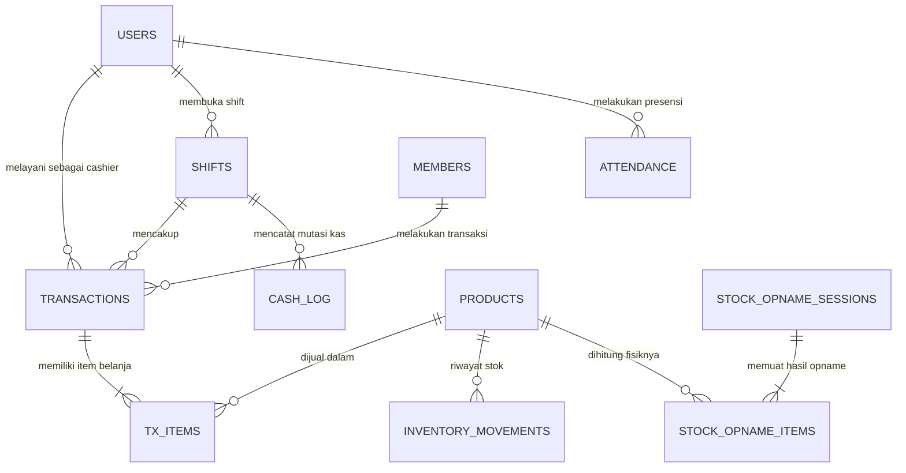

# Database Schema & Data Models — Baiturrahman Mart

Dokumen ini mendefinisikan skema tabel lengkap pada **SQLite lokal (`ymb-mart.db`)** dan **Turso Cloud (libSQL)**.

---

## 1. Relasi Entitas Utama (ERD)



---

## 2. Definisi Skema Tabel

### A. Tabel Autentikasi & Pengguna

#### `users`
Menyimpan akun kasir dan administrator sistem.
```sql
CREATE TABLE users (
    id INTEGER PRIMARY KEY AUTOINCREMENT,
    username TEXT UNIQUE NOT NULL,
    password TEXT NOT NULL,                -- bcrypt hash
    display_name TEXT DEFAULT '',
    role TEXT DEFAULT 'kasir',             -- 'admin' | 'kasir'
    active INTEGER DEFAULT 1,              -- 1 = aktif, 0 = nonaktif
    password_changed INTEGER DEFAULT 0,    -- 0 = default, 1 = sudah diganti
    sync_status TEXT DEFAULT 'synced'      -- 'synced' | 'pending'
);
```

#### `active_sessions`
Menyimpan token sesi aktif untuk mendukung environment serverless Vercel.
```sql
CREATE TABLE active_sessions (
    token TEXT PRIMARY KEY,
    role TEXT NOT NULL,
    username TEXT NOT NULL,
    expires_at TEXT NOT NULL               -- ISO 8601 string
);
```

---

### B. Tabel Master Inventaris & Katalog

#### `products`
Master data produk toko.
```sql
CREATE TABLE products (
    id INTEGER PRIMARY KEY AUTOINCREMENT,
    sku TEXT UNIQUE NOT NULL,
    name TEXT NOT NULL,
    description TEXT DEFAULT '',
    price INTEGER DEFAULT 0,               -- Harga Jual (Rupiah)
    cost INTEGER DEFAULT 0,                -- Harga Beli / Pokok (Rupiah)
    category TEXT DEFAULT 'Umum',
    stock INTEGER DEFAULT 0,               -- Stok Fisik Tersedia
    min_stock INTEGER DEFAULT 0,           -- Batas Minimum Peringatan Restock
    reserved_stock INTEGER DEFAULT 0,      -- Stok yang Ditahan Pesanan Online
    unit TEXT DEFAULT 'pcs',               -- Satuan (pcs, kg, bks, botol, dll)
    barcode TEXT DEFAULT '',
    promo_price INTEGER DEFAULT 0,
    promo_active INTEGER DEFAULT 0,        -- 1 = aktif diskon promo
    tax_rate REAL DEFAULT -1,              -- -1 = ikut default sistem, 0 = bebas pajak
    active INTEGER DEFAULT 1,              -- 1 = aktif dijual
    created_at TIMESTAMP DEFAULT CURRENT_TIMESTAMP,
    sync_status TEXT DEFAULT 'pending'     -- 'synced' | 'pending'
);
```

#### `categories`
```sql
CREATE TABLE categories (
    id INTEGER PRIMARY KEY AUTOINCREMENT,
    name TEXT UNIQUE NOT NULL,
    icon TEXT DEFAULT '📦'
);
```

#### `inventory_movements`
Kartu stok (Audit trail pergerakan inventaris).
```sql
CREATE TABLE inventory_movements (
    id INTEGER PRIMARY KEY AUTOINCREMENT,
    product_id INTEGER NOT NULL REFERENCES products(id),
    movement_type TEXT NOT NULL,           -- 'IN', 'OUT', 'SALE', 'OPNAME', 'ADJUSTMENT'
    quantity INTEGER NOT NULL,
    stock_before INTEGER NOT NULL,
    stock_after INTEGER NOT NULL,
    reference_type TEXT DEFAULT '',        -- 'transaction', 'opname', 'manual'
    reference_id TEXT DEFAULT '',
    source TEXT NOT NULL DEFAULT 'manual',
    reason TEXT DEFAULT '',
    user TEXT DEFAULT '',
    created_at TIMESTAMP DEFAULT CURRENT_TIMESTAMP,
    sync_status TEXT DEFAULT 'pending'
);
```

---

### C. Tabel Transaksi & Kasir

#### `transactions`
```sql
CREATE TABLE transactions (
    id INTEGER PRIMARY KEY AUTOINCREMENT,
    tx_id TEXT UNIQUE NOT NULL,            -- e.g. "TRX-20261115-001"
    shift_id INTEGER,                      -- ID shift yang sedang aktif
    total INTEGER DEFAULT 0,
    discount INTEGER DEFAULT 0,
    tax INTEGER DEFAULT 0,
    grand_total INTEGER DEFAULT 0,
    payment TEXT DEFAULT 'CASH',           -- 'CASH', 'QRIS', 'TRANSFER'
    amount_paid INTEGER DEFAULT 0,
    change_amount INTEGER DEFAULT 0,
    customer_name TEXT DEFAULT '',
    member_id INTEGER DEFAULT NULL,
    cashier TEXT DEFAULT 'kasir',
    notes TEXT DEFAULT '',
    status TEXT DEFAULT 'completed',       -- 'completed', 'refunded', 'cancelled'
    created_at TIMESTAMP DEFAULT CURRENT_TIMESTAMP,
    sync_status TEXT DEFAULT 'pending'
);
```

#### `tx_items`
```sql
CREATE TABLE tx_items (
    id INTEGER PRIMARY KEY AUTOINCREMENT,
    tx_id TEXT NOT NULL,
    product_id INTEGER,
    name TEXT NOT NULL,
    qty INTEGER DEFAULT 1,
    price INTEGER DEFAULT 0,
    discount INTEGER DEFAULT 0,
    subtotal INTEGER DEFAULT 0,
    notes TEXT DEFAULT ''
);
```

#### `shifts`
```sql
CREATE TABLE shifts (
    id INTEGER PRIMARY KEY AUTOINCREMENT,
    shift_name TEXT NOT NULL,
    cashier TEXT NOT NULL,
    opened_at TIMESTAMP DEFAULT CURRENT_TIMESTAMP,
    closed_at TIMESTAMP DEFAULT NULL,
    opening_cash INTEGER DEFAULT 0,        -- Modal Awal
    closing_cash INTEGER DEFAULT 0,        -- Uang Fisik Diinput Kasir
    expected_cash INTEGER DEFAULT 0,       -- Uang Seharusnya (Modal + Tunai - Kas Keluar)
    cash_sales INTEGER DEFAULT 0,          -- Total Penjualan Tunai
    cash_out INTEGER DEFAULT 0,            -- Total Kas Kecil Keluar
    cash_discrepancy INTEGER DEFAULT 0,    -- Selisih (closing_cash - expected_cash)
    total_sales INTEGER DEFAULT 0,         -- Total Penjualan (Tunai + QRIS)
    total_tx INTEGER DEFAULT 0,
    status TEXT DEFAULT 'open',            -- 'open', 'closed'
    sync_status TEXT DEFAULT 'pending'
);
```

#### `cash_log`
Pencatatan kas kecil laci (Petty cash masuk / keluar).
```sql
CREATE TABLE cash_log (
    id INTEGER PRIMARY KEY AUTOINCREMENT,
    shift_id INTEGER,
    type TEXT NOT NULL,                    -- 'IN' (Tambah Modal/Receh), 'OUT' (Operasional/Setor)
    amount INTEGER DEFAULT 0,
    description TEXT DEFAULT '',
    created_at TIMESTAMP DEFAULT CURRENT_TIMESTAMP,
    sync_status TEXT DEFAULT 'pending'
);
```

---

### D. Tabel Member, Presensi & Operasional

#### `members`
```sql
CREATE TABLE members (
    id INTEGER PRIMARY KEY AUTOINCREMENT,
    member_id TEXT UNIQUE NOT NULL,        -- e.g. "MBR-001"
    name TEXT NOT NULL,
    phone TEXT DEFAULT '',
    email TEXT DEFAULT '',
    points INTEGER DEFAULT 0,
    tier TEXT DEFAULT 'basic',             -- 'basic', 'silver', 'gold'
    active INTEGER DEFAULT 1,
    created_at TIMESTAMP DEFAULT CURRENT_TIMESTAMP,
    sync_status TEXT DEFAULT 'pending'
);
```

#### `attendance`
Pencatatan presensi kasir (Clock In / Clock Out).
```sql
CREATE TABLE attendance (
    id INTEGER PRIMARY KEY AUTOINCREMENT,
    user_id INTEGER,
    username TEXT NOT NULL,
    cashier_name TEXT NOT NULL,
    type TEXT NOT NULL,                    -- 'CLOCK_IN', 'CLOCK_OUT'
    date TEXT NOT NULL,                    -- 'YYYY-MM-DD'
    time TEXT NOT NULL,                    -- 'HH:MM:SS'
    notes TEXT DEFAULT '',
    device_info TEXT DEFAULT '',
    created_at TIMESTAMP DEFAULT CURRENT_TIMESTAMP,
    sync_status TEXT DEFAULT 'pending'
);
```

#### `stock_opname_sessions` & `stock_opname_items`
```sql
CREATE TABLE stock_opname_sessions (
    id INTEGER PRIMARY KEY AUTOINCREMENT,
    opname_date TEXT,
    notes TEXT,
    created_by TEXT NOT NULL,
    status TEXT DEFAULT 'open',            -- 'open', 'closed'
    created_at DATETIME DEFAULT CURRENT_TIMESTAMP,
    closed_at DATETIME,
    sync_status TEXT DEFAULT 'pending'
);

CREATE TABLE stock_opname_items (
    id INTEGER PRIMARY KEY AUTOINCREMENT,
    session_id INTEGER NOT NULL REFERENCES stock_opname_sessions(id),
    product_id INTEGER NOT NULL REFERENCES products(id),
    system_qty INTEGER NOT NULL,
    physical_qty INTEGER,
    difference INTEGER,
    scanned_at DATETIME,
    user TEXT,
    sync_status TEXT DEFAULT 'pending',
    UNIQUE(session_id, product_id)
);
```

#### `settings`
Key-Value store untuk konfigurasi toko & banner layar pelanggan.
```sql
CREATE TABLE settings (
    key TEXT PRIMARY KEY,
    value TEXT NOT NULL
);
```
*Kunci penting: `store_name`, `store_address`, `store_phone`, `opening_cash`, `qris_merchant`, `ad_marquee`, `ad_images`, `public_presensi_url`, `etrans_admin_fee`.*

