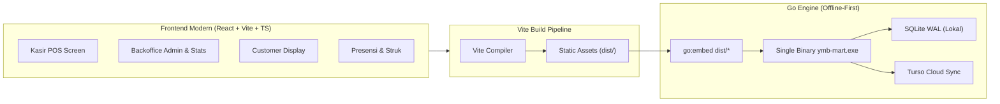
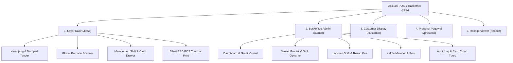
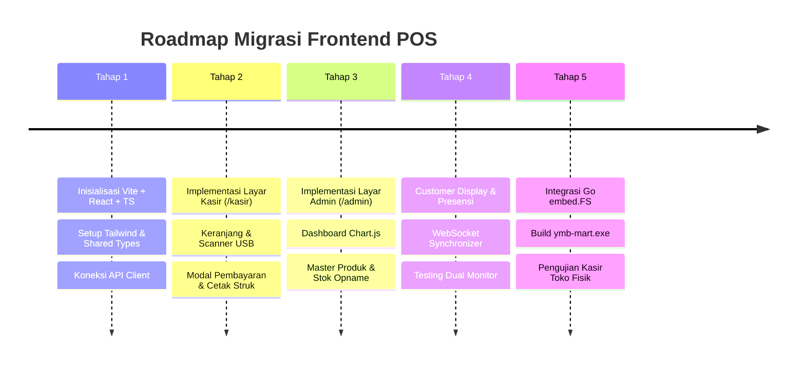

# PRD: Migrasi Frontend POS & Backoffice ke React + Vite (Go Embedded App)

**Dokumen**: Product Requirements Document (PRD)  
**Versi**: 1.0.0  
**Tanggal**: 14 November 2026  
**Status**: Ready for Review / Execution  
**Target Sistem**: Baiturrahman Mart (YMB Mart) Desktop POS & Backoffice Web  

---

## 1. Executive Summary & Problem Statement

### 1.1 Latar Belakang
Aplikasi Point of Sales (POS) Baiturrahman Mart saat ini menggunakan arsitektur **Go Backend + Vanilla HTML/CSS/JS** yang di-embed langsung ke dalam binary file (`embed.go`). Arsitektur ini sangat portabel dan cepat, namun seiring bertambahnya fitur toko fisik dan integrasi e-commerce mobile, frontend berbasis Vanilla HTML menghadapi kendala:

1. **Monolithic Spaghetti Code**: File [`frontend/admin.html`](file:///c:/sites/ymb-mart/frontend/admin.html) mencapai >220 KB (>3.500 baris) dan [`frontend/kasir.html`](file:///c:/sites/ymb-mart/frontend/kasir.html) mencapai >115 KB (>2.000 baris) dalam satu file HTML campuran inline JavaScript dan CSS.
2. **Duplikasi Kode & Logika**: Logika perhitungan pajak, diskon, format mata uang, serta penanganan koneksi WebSocket diduplikasi di `kasir.html`, `admin.html`, dan `customer.html`.
3. **Ketiadaan Type Safety**: Interaksi data dengan REST API Go rawan bug tipe data (`null` vs `undefined`, integer vs string), terutama saat sinkronisasi stok dan shift kasir.
4. **Isolasi dari Aplikasi Mobile**: Aplikasi mobile Baiturrahman Mart (`mobile/`) telah menggunakan arsitektur modern (**React Native + TypeScript + Zustand + Lucide**). Frontend POS belum bisa memanfaatkan komponen logika yang sudah ada di mobile.

### 1.2 Solusi yang Ditetapkan
Melakukan migrasi frontend POS ke **Single Page Application (SPA)** modern berbasis **React 19, TypeScript, Vite, dan Tailwind CSS**. 

Hasil build statis (`dist/`) tetap di-embed ke dalam binary Go melalui fitur `embed.FS` (`//go:embed dist/*`). Pengguna tetap mendapatkan **satu file `.exe` mandiri** untuk PC kasir offline, sekaligus otomatis dapat dideploy ke **Vercel Serverless** tanpa mengubah arsitektur backend.



---

## 2. Tujuan & Batasan Proyek (Goals & Non-Goals)

### 2.1 Tujuan Utama (Goals)
1. **Peningkatan Maintainability & Modularitas**: Memecah file raksasa menjadi komponen-komponen terisolasi (`ProductTable`, `CartPanel`, `PaymentModal`, `ShiftDrawer`, dll).
2. **Type-Safety End-to-End**: Menggunakan TypeScript untuk menjamin konsistensi payload transaksi, produk, member, dan pergerakan kas.
3. **100% Code Sharing Logic dengan Mobile**: Berbagi tipe data (`Product`, `CartItem`, `PlacedOrder`), logika state (`Zustand`), dan utilitas format mata uang dengan aplikasi mobile yang sudah ada.
4. **Preservasi 100% Fitur POS Hardware**:
   - Silent direct printing ke printer kasir thermal (58mm/80mm) via Chrome Kiosk Mode.
   - Intersepsi input Barcode Scanner USB/HID tanpa harus memfokuskan kursor ke input box.
   - Hotkey keyboard kasir cepat (F1-F12, Spasi, Esc, Enter).
5. **Tetap Single Executable**: Output akhir tetap satu file `.exe` Windows yang dapat dijalankan secara portabel tanpa instalasi Node.js di PC kasir.

### 2.2 Batasan (Non-Goals)
1. **Tidak Menulis Ulang Backend**: Endpoint Go, schema SQLite, dan algoritma sync Turso tetap dipertahankan tanpa perubahan kontrak API.
2. **Tidak Menggunakan Electron**: Menghindari overhead Electron (>150MB installer dan >250MB RAM). Tetap menggunakan browser native host via Go launcher.

---

## 3. Spesifikasi Arsitektur & Tech Stack

| Layer | Teknologi Terpilih | Alasan Pemilihan |
|---|---|---|
| **Language** | TypeScript 5.x | Keamanan tipe data, autocomplete, pencegahan bug runtime |
| **Framework** | React 19 (atau 18 LTS) | Kompatibel penuh dengan logic ekosistem mobile repo ini |
| **Bundler** | Vite 6 | Kecepatan build instan (<2 detik) dan HMR super responsif |
| **State Management** | Zustand | Sangat ringan (<3KB), zero-boilerplate, identik dengan `mobile/src/stores` |
| **Data Fetching / Cache** | TanStack Query v5 | Auto-retry, caching produk offline, revalidasi data transaksi |
| **Styling** | Tailwind CSS v4 | Utilitas cepat, ukuran CSS minimal (<20KB gzipped), palet warna konsisten (`#8b1538`) |
| **Icons** | Lucide React | Modern, konsisten 1:1 dengan ikon di mobile app |
| **Charts** | Chart.js 4 + react-chartjs-2 | Visualisasi omzet, shift, dan produk terlaris di dashboard admin |
| **UI Components** | Radix UI / Headless UI | Aksesibilitas penuh untuk navigasi keyboard kasir |

---

## 4. Scope Fitur & Modul Aplikasi



### 4.1 Modul 1: Layar Kasir Utama (`/kasir`)
Layar kerja kasir berkecepatan tinggi dengan layout split 2 kolom:
- **Kolom Kiri (Katalog & Pencarian)**:
  - Input pencarian real-time (Nama produk, SKU, Barcode).
  - Filter kategori cepat berbentuk chips.
  - Grid produk dengan visualisasi stok fisik dan stok reservasi online.
  - Badge peringatan jika stok menipis (`min_stock`).
- **Kolom Kanan (Keranjang & Pembayaran)**:
  - Tabel keranjang belanja interaktif: ubah qty langsung, catatan item, diskon per item.
  - Subtotal, diskon kupon/member, pajak PPN dinamis, dan infaq masjid.
  - Tombol aksi cepat: **Hold Transaksi**, **Recall Transaksi Tertunda**, **Void/Batal**.
  - Modal Pembayaran Lengkap:
    - **Tunai**: Numpad sentuh + tombol nominal uang pas & pecahan instan (Rp10rb, Rp20rb, Rp50rb, Rp100rb).
    - **QRIS Dinamis**: Tampil QRIS otomatis di layar kasir dan customer display.
    - **Transfer Bank / Debit**: Verifikasi referensi nomor kartu.
- **Hardware Integrations**:
  - Global listener barcode USB tanpa dependensi fokus elemen.
  - Shortcut kasir: `F2` (Pencarian), `F4` (Member), `F8` (Hold), `F9` (Bayar), `Esc` (Batal).
  - Print trigger via format CSS `@media print` 58mm/80mm ke printer kasir thermal.

### 4.2 Modul 2: Backoffice Admin & Analytics (`/admin`)
Pusat manajemen manajer dan pengurus masjid:
- **Dashboard Analitik**: Kartu ringkasan omzet harian/bulanan, laba kotor, jumlah transaksi, dan grafik tren jam sibuk (menggunakan Chart.js).
- **Master Produk & Kategori**: CRUD produk lengkap dengan kalkulator margin laba otomatis, upload foto, cetak barcode label, dan pengaturan stok minimum.
- **Sesi Stok Opname (Stock Opname)**: Buka sesi opname fisik rak, scan barcode barang, hitung selisih fisik vs sistem, dan penyesuaian otomatis (*inventory adjustment*).
- **Laporan Shift & Kas**: Rekap kas masuk/keluar, modal awal kasir, kas akhir, selisih kas (*cash discrepancy*), dan riwayat setoran uang.
- **Manajemen Member & Reward**: Input data jemaah, level tier (Reguler, Silver, Gold), dan riwayat transaksi member.
- **Audit Log & Sinkronisasi Cloud**: Pemantauan antrean sync ke Turso Cloud, status koneksi offline/online, dan log aktivitas staf toko.

### 4.3 Modul 3: Customer Facing Display (`/customer`)
Layar kedua yang menghadap ke pelanggan/pembeli:
- Berjalan terpisah di monitor kedua atau tablet.
- Terhubung via **WebSocket Go (`/ws`)**:
  - Saat kasir memindai item, layar customer seketika memperbarui daftar belanja dan total.
  - Saat kasir memilih metode QRIS, layar customer langsung memunculkan kode QRIS besar siap scan.
  - Saat idle, memutar slider pengumuman kegiatan masjid dan promo mingguan toko.

### 4.4 Modul 4: Presensi Mandiri Struk Kasir (`/presensi` & `/receipt`)
- Presensi jam masuk dan jam pulang kasir dengan scan QR / kamera.
- Halaman cetak ulang struk digital atau unduh bukti transaksi via tautan publik.

---

## 5. Rencana Struktur Direktori Proyek

Proyek frontend baru akan ditempatkan di dalam folder terisolasi `frontend-app/`:

```text
ymb-mart/
├── frontend-app/               <-- Project Baru React + Vite
│   ├── src/
│   │   ├── assets/             <-- Gambar, logo toko, audio beep scanner
│   │   ├── components/         <-- Komponen atomik (Button, Modal, Table, Badge)
│   │   │   ├── common/
│   │   │   ├── pos/            <-- CartTable, ProductGrid, NumpadTender, HoldModal
│   │   │   ├── admin/          <-- StatsCard, RevenueChart, ProductForm, ShiftDetail
│   │   │   └── customer/       <-- DualScreenCart, QrisDisplay
│   │   ├── hooks/              <-- useBarcodeScanner, useHotkeys, useWebSocket
│   │   ├── pages/
│   │   │   ├── pos/            <-- Halaman Utama Kasir
│   │   │   ├── admin/          <-- Halaman Backoffice Dashboard & Sub-menu
│   │   │   ├── customer/       <-- Halaman Customer Display
│   │   │   ├── presensi/       <-- Halaman Absensi Karyawan
│   │   │   └── receipt/        <-- Halaman Struk Transaksi
│   │   ├── services/           <-- API client fetcher (terkoneksi ke Go backend)
│   │   ├── stores/             <-- Zustand: usePOSStore, useAuthStore, useShiftStore
│   │   ├── types/              <-- TypeScript definitions (shared 1:1 dgn mobile)
│   │   ├── utils/              <-- currency.ts, printHelper.ts, date.ts
│   │   ├── App.tsx             <-- Router (TanStack Router atau React Router v7)
│   │   └── main.tsx
│   ├── package.json
│   ├── tsconfig.json
│   ├── vite.config.ts          <-- Output outDir dikonfigurasi ke ../frontend_dist
│   └── tailwind.config.js
│
├── handlers.go                 <-- Go Backend (Existing)
├── server.go                   <-- Update embed.FS mengarah ke frontend_dist
├── main.go                     <-- Database SQLite & background sync (Existing)
└── mobile/                     <-- Aplikasi Mobile Expo (Existing)
```

---

## 6. Integrasi Hardware & Spesifikasi Non-Fungsional

### 6.1 Barcode Scanning Reliability
- **Event Interceptor**: Script scanner mendengarkan `keydown` pada objek `window`. Jika karakter terketik dengan interval < 35 milidetik diakhiri dengan `Enter`, sistem mengidentifikasikannya sebagai hardware scanner (bukan ketikan manual kasir) dan langsung memasukkan produk ke keranjang.
- **Audio Feedback**: Mengeluarkan suara *beep* sukses (Web Audio API sintetis, tanpa load file eksternal) saat barcode terbaca.

### 6.2 Silent ESC/POS Printing
- Menggunakan CSS Print Stylesheet khusus `@media print`:
  ```css
  @media print {
    body * { visibility: hidden; }
    #printable-receipt, #printable-receipt * { visibility: visible; }
    #printable-receipt { position: absolute; left: 0; top: 0; width: 58mm; }
  }
  ```
- Tetap memicu print via window browser Chrome POS Kiosk:
  ```bash
  chrome --kiosk-printing --user-data-dir=chrome-pos-profile http://localhost:8070/kasir
  ```

### 6.3 Target Kinerja (Performance Benchmarks)
- **Time to First Meaningful Paint (FMP)**: < 400ms (karena semua aset statis di-load dari disk lokal localhost).
- **Latency Barcode Scan ke Input Tabel**: < 20ms.
- **Memori Frontend**: < 60 MB RAM di browser.
- **Ukuran Bundle**: Total JavaScript + CSS hasil build < 350 KB gzipped.

---

## 7. Rencana Tahapan Migrasi & Verifikasi (Milestones)



| Fase | Durasi Estimasi | Output / Deliverable | Kriteria Selesai (Definition of Done) |
|---|---|---|---|
| **Fase 1: Fondasi Proyek** | 1 Hari | Project `frontend-app` (Vite, React 19, TS, Tailwind, Zustand) | Build berhasil, API types cocok dengan response Go backend |
| **Fase 2: Modul Kasir POS** | 2 Hari | UI Kasir baru, Scanner USB, Numpad, Modal Tender, Struk Print | Kasir bisa scan barcode, pilih pembayaran, dan struk tercetak silent |
| **Fase 3: Backoffice Admin** | 2 Hari | Dashboard analitik, Master produk, Laporan shift, Member | CRUD produk lancar, grafik omzet tampil, laporan shift akurat |
| **Fase 4: Customer Display & WS**| 1 Hari | Halaman `/customer` & `/presensi` | Perubahan keranjang kasir langsung muncul di layar customer via WebSocket |
| **Fase 5: Packaging & Go Embed** | 1 Hari | Update `server.go` embed path, compile single `.exe` | Menjalankan `ymb-mart.exe` langsung membuka UI React tanpa node_modules |

---

## 8. Manajemen Risiko & Mitigasi

| Potensi Risiko | Dampak | Mitigasi yang Diterapkan |
|---|---|---|
| Kioskasir gagal silent print struk | Tinggi | Pertahankan profil Chrome POS yang sudah ada (`--kiosk-printing`). Jangan ubah mekanisme print browser. |
| Ukuran file executable Go membengkak | Rendah | Mengaktifkan Gzip/Brotli compression di Vite dan tree-shaking library icon Lucide. Tambahan ukuran di binary < 3 MB. |
| Internet mati saat kasir beroperasi | Sedang | Seluruh aset SPA di-host secara lokal oleh binary Go di port 8070. Tetap 100% offline-first. |
| Routing 404 saat refresh halaman SPA | Sedang | Tambahkan catch-all fallback handler di router Go `server.go` agar selalu mengembalikan `index.html` untuk route SPA. |

---

> [!NOTE]
> Setelah PRD ini disetujui, langkah teknis pertama yang akan dieksekusi adalah **Fase 1: Setup project `frontend-app` dengan Vite, Tailwind CSS, dan integrasi tipe data shared**.
