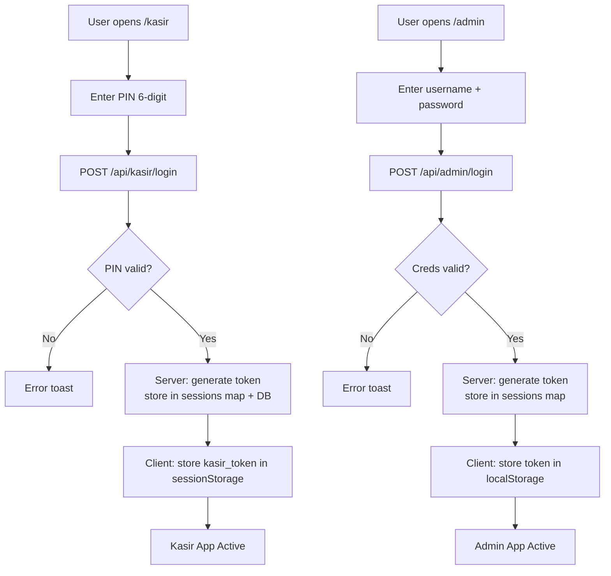
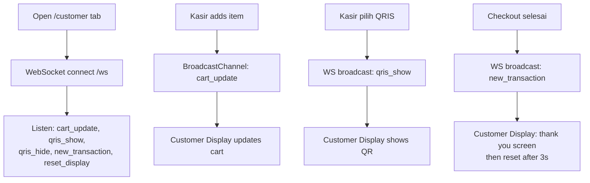
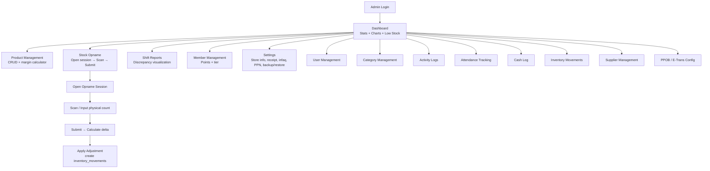
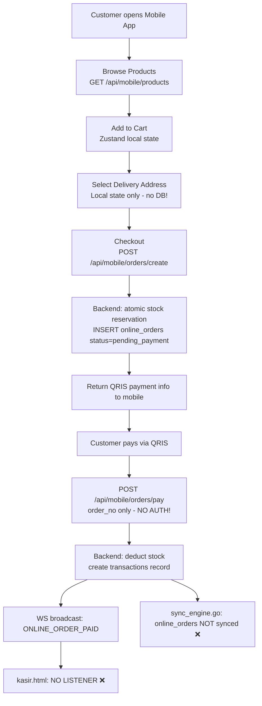
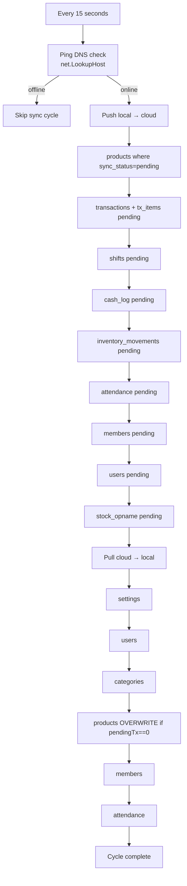

# YMB Mart — Comprehensive Flow Audit

> Generated: 2026-11-20 | Model: Claude Sonnet 4.6 | Scope: Full-stack POS (Go + SQLite + React + RN)

---

## 0. Stack Snapshot

| Layer | Tech | Status |
|---|---|---|
| Backend | Go, net/http ServeMux, Gorilla WebSocket | ✅ Solid |
| Database (local) | SQLite WAL, modernc (pure-Go, no CGO) | ✅ Solid |
| Database (cloud) | Turso / libSQL | ✅ Solid |
| Sync Engine | Custom Go goroutine, 15s interval | ⚠️ Gaps exist |
| Frontend (default) | Vanilla HTML5, Tailwind CDN, inline JS | ⚠️ Monolithic |
| Frontend (v2/preview) | React 19, Vite, Zustand, TanStack Query | ✅ Ready |
| Mobile | React Native 0.86.3, Expo SDK 57 | ⚠️ Security gap |
| Auth | In-memory session map + DB fallback, HMAC CSRF | ⚠️ Gaps exist |

---

## 1. Auth & Session Flow

### Flow Diagram



### Issues

| # | Severity | Issue |
|---|---|---|
| A-1 | 🟡 Medium | `kasir_token` in **sessionStorage** vs `token` (admin) in **localStorage** — inconsistent. Closing kasir tab = token lost = kasir must re-login mid-shift. |
| A-2 | 🟡 Medium | In-memory `sessions` map is **not persisted across server restart**. If POS exe crashes during shift, kasir must re-login. |
| A-3 | 🟡 Medium | `validateCSRF` returns `true` if token is empty AND session is valid — CSRF is bypassable from same-origin JS (no token needed). |
| A-4 | 🟢 Low | Two separate auth namespaces cause confusion if both /kasir and /admin open in same browser. No conflict but developer footgun. |

### Fixes

```
A-1: Move kasir_token to localStorage with explicit expiry check
     (match shift_end or 12h, whichever shorter)

A-2: Session map already falls back to DB — OK on restart.
     Verify: handlers.go validateSession() DB path is exercised.

A-3: Enforce CSRF token presence on all mutating endpoints,
     remove the "empty token = ok" bypass.
```

---

## 2. POS Kasir Flow (Legacy HTML — Default)

### Flow Diagram

```mermaid
flowchart TD
    LOGIN[Login PIN] --> SHIFT_CHECK{Shift Open?}
    SHIFT_CHECK -- No --> OPEN_SHIFT[Open Shift\nModal: modal masukkan saldo awal]
    OPEN_SHIFT --> POS
    SHIFT_CHECK -- Yes --> POS

    POS[POS Screen] --> SCAN[Scan Barcode / Search Product\nF2 focus search]
    SCAN --> CART[Add to Cart]
    CART --> QTY[Adjust Qty / Price Override]
    QTY --> DISCOUNT[Apply Discount %]
    DISCOUNT --> MEMBER[Lookup Member\nF4: scan kartu member]
    MEMBER --> INFAQ[Toggle Infaq\nF9]
    INFAQ --> PAYMENT

    PAYMENT[Bayar Modal] --> CASH[Tunai\nAuto-calculate kembalian]
    PAYMENT --> QRIS[QRIS\nShow QR → Customer Display broadcast]
    PAYMENT --> TRANSFER[Transfer Bank]

    CASH --> CHECKOUT
    QRIS --> CHECKOUT
    TRANSFER --> CHECKOUT

    CHECKOUT[POST /api/transactions] --> PRINT[Print Receipt\nESC/POS via printReceipt()]
    PRINT --> BROADCAST[BroadcastChannel: new_transaction\nCustomer Display reset]
    BROADCAST --> POS

    POS --> HOLD[Hold Cart\nF8: park current cart]
    HOLD --> RECALL[Recall Cart\nF8: list parked]
    POS --> ETRANS[E-Trans PPOB\nF3]
    POS --> SHIFT_CLOSE[Tutup Shift\nDenomination modal]
```

### Issues

| # | Severity | Issue |
|---|---|---|
| K-1 | 🔴 Critical | **No listener for `ONLINE_ORDER_PAID` WebSocket event** in kasir.html. Backend fires this but kasir never receives it — online orders are invisible to kasir. |
| K-2 | 🟡 Medium | `kasir.html` is **117KB single file** — logic, style, layout all inline. Extremely hard to maintain, debug, or extend. |
| K-3 | 🟡 Medium | Receipt print relies on `window.print()` — works only if browser print dialog maps to thermal printer. No direct ESC/POS integration at app layer. |
| K-4 | 🟢 Low | Price override (manual harga) has no manager approval flow — any kasir can sell at Rp0. |
| K-5 | 🟢 Low | F-key shortcuts not labeled in UI — new kasir has no discoverability. |

---

## 3. Customer Display Flow

### Flow Diagram



### Issues

| # | Severity | Issue |
|---|---|---|
| C-1 | 🟡 Medium | **No reconnect / state recovery** on WebSocket disconnect. If network blinks, display goes blank and shows stale cart until manually refreshed. |
| C-2 | 🟡 Medium | BroadcastChannel only works **same machine, same browser profile**. If customer display is on a separate device (TV/monitor via second PC), BroadcastChannel fails silently — only WS works. The dual-channel approach is confusing. |
| C-3 | 🟢 Low | QRIS image shown on customer display is static (from `/qris.png` file) — kasir must manually update the image file for different payment amounts. |

---

## 4. Admin Backoffice Flow

### Flow Diagram



### Issues

| # | Severity | Issue |
|---|---|---|
| ADM-1 | 🔴 Critical | **Stock Opname race condition**: No lock prevents kasir from selling items currently being counted. Physical count becomes invalid if sales happen mid-session. |
| ADM-2 | 🔴 Critical | **`/api/restore` replaces SQLite file without sync state check**. If cloud has newer data, restore from old backup corrupts sync IDs (last_sync_id mismatch). |
| ADM-3 | 🟡 Medium | `admin.html` is **223KB single file** — worse than kasir.html. Any change requires careful grep to avoid breaking unrelated sections. |
| ADM-4 | 🟡 Medium | Dashboard charts use inline Chart.js via CDN — no version pinning, subject to CDN outage. |
| ADM-5 | 🟢 Low | Low stock alert threshold is global (settings). No per-product threshold. |
| ADM-6 | 🟢 Low | No export to CSV/Excel for shift reports, inventory — common request from supervisors. |

---

## 5. Online Order / Mobile Flow

### Flow Diagram



### Issues

| # | Severity | Issue |
|---|---|---|
| MOB-1 | 🚨 **BLOCKER** | **`/api/mobile/orders/pay` has ZERO authentication**. Any HTTP client knowing an order_no can trigger paid status + stock deduction without paying. This is an open exploit. |
| MOB-2 | 🔴 Critical | **`ONLINE_ORDER_PAID` WS event has no listener in kasir.html** — kasir never sees incoming online orders (duplicate of K-1). |
| MOB-3 | 🔴 Critical | **`online_orders` table never included in sync_engine.go** — orders created via Vercel/cloud backend exist only in cloud SQLite, never reach local kasir PC. |
| MOB-4 | 🔴 Critical | **`customer_addresses` table does not exist** in main.go schema. Mobile stores addresses in Zustand only — lost on reinstall. |
| MOB-5 | 🟡 Medium | No payment expiry enforcement — `pending_payment` orders can sit forever, holding reserved stock. |
| MOB-6 | 🟡 Medium | Mobile app shows products from cloud API — if cloud is down, entire app fails. No local cache TTL strategy. |
| MOB-7 | 🟢 Low | No push notification when order status changes (pending → processing → ready → delivered). |

---

## 6. Sync Engine Flow

### Flow Diagram



### Issues

| # | Severity | Issue |
|---|---|---|
| SYNC-1 | 🔴 Critical | **`online_orders` absent from both push and pull cycles**. Mobile orders are created on cloud, never reach local kasir DB. |
| SYNC-2 | 🔴 Critical | **Stock overwrite risk**: when `pendingTx == 0`, pull blindly overwrites local `products.stock` with cloud value. Local opname adjustments not yet pushed will be silently lost. |
| SYNC-3 | 🟡 Medium | **No conflict resolution strategy** documented or implemented. Last-write-wins for most fields. If kasir and cloud both update same product concurrently, one update is silently dropped. |
| SYNC-4 | 🟡 Medium | **DNS ping to check connectivity is fragile** — DNS can resolve but API endpoint can be down (Turso outage, Vercel down). Should ping the actual API health endpoint. |
| SYNC-5 | 🟢 Low | 15-second interval is hardcoded. Should be configurable via settings for slow networks. |
| SYNC-6 | 🟢 Low | No retry backoff on sync failure — hammers cloud with requests even during outages. |

---

## 7. Tech Stack Assessment

### Keep — No Changes Needed

| Tech | Verdict | Reason |
|---|---|---|
| **Go backend** | ✅ Keep | Excellent for this: single binary, low memory, fast startup, easy cross-compile for Windows. |
| **SQLite + WAL** | ✅ Keep | Perfect for offline-first retail POS. Proven, zero-config, embedded. |
| **Turso/libSQL** | ✅ Keep | Solid cloud SQLite layer. Edge replication good fit. |
| **React 19 + Vite** | ✅ Keep | Modern, fast DX. Use incrementally via /v2. |
| **React Native + Expo** | ✅ Keep | Correct choice for mobile. Expo SDK 57 is current. |
| **Zustand + TanStack Query** | ✅ Keep | Minimal, correct choice for state management. |
| **Tailwind CSS v4** | ✅ Keep | Config-lite, fast builds. |

### Change / Add

| Concern | Current | Recommendation |
|---|---|---|
| **Mobile payment security** | No auth on `/pay` endpoint | Implement HMAC webhook signature (Midtrans standard) — 10 lines of Go, no new dependency. |
| **Monolithic HTML** | kasir.html 117KB, admin.html 223KB | Don't rewrite now. Migrate module-by-module to React `/v2` over time. |
| **CDN dependencies** | Tailwind CDN, Chart.js CDN in HTML | For production: bundle Tailwind into CSS file, bundle Chart.js — eliminates CDN risk. |
| **Session storage** | sessionStorage for kasir token | Switch to localStorage with TTL for kasir token. |
| **Payment expiry** | None | Add `expires_at` column to `online_orders`, cron job to cancel stale orders and release stock. |

### Do NOT Change

- Do NOT switch to PostgreSQL — SQLite is intentional for offline-first.
- Do NOT add Redis — overkill for single-node retail POS.
- Do NOT adopt gRPC — REST is correct for this client profile.
- Do NOT rewrite backend in Node/Python — Go binary is a deployment advantage.

---

## 8. Prioritized Fix Roadmap

> Rule: satu per satu, dapat approval sebelum lanjut.

| Priority | Fix | File(s) | Effort | Status |
|---|---|---|---|---|
| 🚨 **P0** | Secure `/api/mobile/orders/pay` with HMAC sig verification | `handlers.go`, `mobile/src/services/api.ts` | 2–3 jam | ✅ **Selesai** |
| 🚨 **P0** | Add `ONLINE_ORDER_PAID` WS listener to kasir.html + audio bell + order modal | `frontend/kasir.html`, `server.go`, `handlers.go` | 2–3 jam | ✅ **Selesai** |
| 🔴 **P1** | Add `online_orders` to sync_engine.go (pull & push cycle) | `sync_engine.go` | 2 jam | ✅ **Selesai** |
| 🔴 **P1** | Create `customer_addresses` table & API CRUD | `main.go`, `handlers.go`, `server.go`, `sync_engine.go`, `mobile/` | 30 menit | ✅ **Selesai** |
| 🔴 **P1** | Fix stock overwrite in sync pull (guard with opname session check) | `sync_engine.go` | 1 jam | ✅ **Selesai** |
| 🔴 **P1** | Stock opname session lock — prevent sales of items in active count | `handlers.go`, `frontend/kasir.html` | 3–4 jam | ✅ **Selesai** |
| 🟡 **P2** | Move kasir_token to localStorage with TTL | `frontend/kasir.html` | 30 menit | ✅ **Selesai** |
| 🟡 **P2** | WS reconnect with exponential backoff + state recovery in customer display | `handlers.go`, `server.go`, `frontend/customer.html` | 1–2 jam | ✅ **Selesai** |
| 🟡 **P2** | Add `expires_at` to `online_orders` + cron to auto-cancel stale | `main.go`, `handlers.go` | 1–2 jam | ✅ **Selesai** |
| 🟡 **P2** | Fix CSRF: enforce token presence on all mutations | `handlers.go`, `server.go`, `frontend/` | 1 jam | ✅ **Selesai** |
| 🟡 **P2** | Replace CDN Tailwind/Chart.js with bundled versions in legacy HTML | `frontend/vendor/`, `scripts/build-vendor.mjs` | 2–3 jam | ✅ **Selesai** |
| 🟢 **P3** | Sync connectivity check: ping API health instead of DNS | `sync_engine.go` | 30 menit | ✅ **Selesai** |
| 🟢 **P3** | Sync retry with exponential backoff | `sync_engine.go` | 1 jam | ✅ **Selesai** |
| 🟢 **P3** | Per-product low stock threshold | `main.go`, admin UI | 2 jam | ✅ **Selesai** |
| 🟢 **P3** | Export CSV for shift reports / inventory | `handlers.go`, admin UI | 2–3 jam | ✅ **Selesai** |
| 🟢 **P4** | Manager approval for price override | `handlers.go`, kasir UI | 3–4 jam | ✅ **Selesai** |
| 🟢 **P4** | Push notifications for mobile order status | Expo Push API | 4–5 jam | ✅ **Selesai** |

---

## 9. Summary

**Dua masalah blocker yang harus diselesaikan sebelum go-live mobile:**

1. **MOB-1 / `ONLINE_ORDER_PAID` listener** — tanpa ini mobile payment tidak aman dan kasir buta terhadap order online.
2. **SYNC-1 / `online_orders` sync** — tanpa ini semua mobile order tidak masuk ke kasir PC.

**Arsitektur keseluruhan sudah solid.** Go + SQLite + Turso adalah pilihan tepat. Tidak perlu ganti tech stack. Yang perlu diperbaiki adalah gap di security layer mobile dan incomplete sync cycle.

**Legacy HTML kasir/admin** boleh tetap default selama migrasi ke React v2 berlangsung bertahap. Dual-mode routing yang sudah dipasang di `server.go` adalah approach yang benar.
